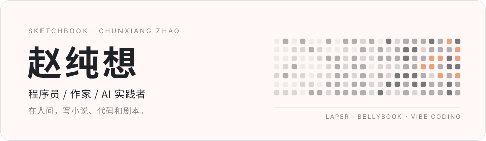

<!--
[INPUT]: chunxiang.ai 公开资料（身份、产品、文章、荣誉、社交链接）；assets/banner.svg 由 scripts/banner.py 生成。
[OUTPUT]: GitHub 个人主页首屏：横幅、联系入口、在做的产品、在写的作品、2025 荣誉。
[POS]: liseami 的门面。置顶仓库与贡献图紧随其下，故本文件不重复列开源项目。
[PROTOCOL]: 变更时更新此头部，然后检查 CLAUDE.md
-->

  
  

    <a href="https://chunxiang.ai">chunxiang.ai</a> ·
    <a href="https://x.com/chunxiangai">X</a> ·
    <a href="https://xhslink.com/m/7sezk8ZLYkz">小红书</a> ·
    <a href="https://v.douyin.com/yeXbHWhQpEA/">抖音</a>
  

### 在做

- **[Laper](https://laper.ai)** · AI 剧本写作 —— 给编剧使用的写作系统：结构、速度、审美都要有，但作者权不能交出去。
- **胃之书 Bellybook** · 食物记忆 —— 把每天吃过的东西变成记忆、分析和私人档案的 AI 饮食记录产品。
- **[Vibe Coding](https://chunxiang.space)** · 课程 —— 面向中文社区的全栈开发课程，从零开始做 iOS、Android、后端和 AI 应用。

### 在写

- **出版小说** ·《坏一坏》·《人生灿灿》
- **随笔** · [多巴胺成功学](https://chunxiang.ai/blog/dopamine-successology/) —— 关于多巴胺、相信、行动、记忆归因和成功学的一次生化解释。
- **随笔** · [爱情进化史](https://chunxiang.ai/blog/love-evolution-history/) —— 关于爱情如何从永远、身体、账单，退火成屋子里赶也赶不走的幽灵。
- **随笔** · [天山路的红色大门](https://chunxiang.ai/blog/red-gate-on-tianshan-road/) —— 关于上海、租屋、债务、爱情和一场离开的回忆。
- **短篇小说** · [兰州莎莎](https://chunxiang.ai/blog/lanzhou-shasha/) —— 关于兰州、牛肉面、黄河和一个名叫莎莎的女孩。

[全部文章 →](https://chunxiang.ai/blog/)

### 2025

- 极客公园 IF 2025 年度开发者
- 字节跳动即梦 AI UIUX 设计金奖
- 小红书独立开发者大赛 铜奖
